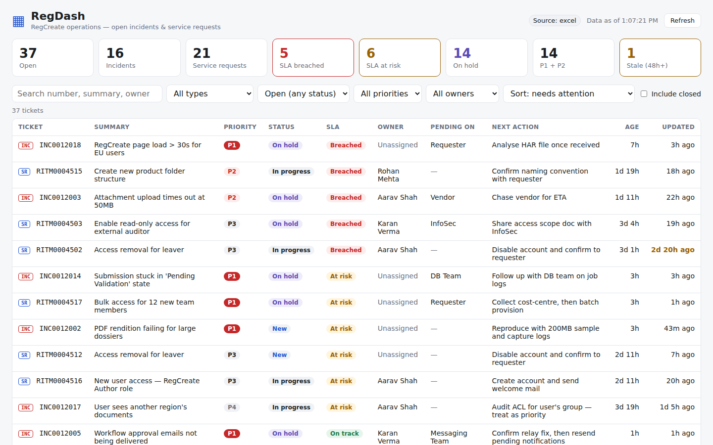

# RegDash

**RegCreate Operations Dashboard.** A live view of the support team's open incidents and service requests: what's open, what's breaching, who owns it, what it's waiting on, and the next action.

Phase 1 (this repo) is read-only visibility. Requirements and design: **[docs/PHASE-1.md](docs/PHASE-1.md)**.



```
regdash/
├── apps/
│   ├── api/          Node + Express + TypeScript: sources, cache, REST API
│   └── web/          React + Vite + TypeScript: the dashboard
├── packages/
│   └── shared/       Ticket types + SLA logic shared by both apps
├── data/
│   └── sample-tickets.xlsx   fake tracker for testing the Excel source
└── docs/PHASE-1.md
```

## Quick start

Needs **Node 22.9+** (the API loads `.env` with `--env-file-if-exists`) and **pnpm** (`npm i -g pnpm` or `corepack enable`).

```bash
pnpm install
pnpm dev          # API on :4000, dashboard on http://localhost:5173
```

That runs on **mock data** with zero setup. No real company data is involved.

## Switching data sources

```bash
cp .env.example apps/api/.env
```

Then set `DATA_SOURCE` in `apps/api/.env`:

| Value | Reads from | Use for |
|---|---|---|
| `mock` (default) | generated fake tickets | development on any machine |
| `excel` | `EXCEL_PATH` (.xlsx) | the team tracker, a local or OneDrive-synced copy of the SharePoint file |
| `servicenow` | ServiceNow Table API | live data (needs a read-only service account) |

To try the Excel source with fake data, run `pnpm sample:excel`, which regenerates `data/sample-tickets.xlsx`, then set `DATA_SOURCE=excel`.

For the **real tracker**, copy the file and check its headers against the alias table in `docs/PHASE-1.md` §7. Most common header names already work. Any rows RegDash can't read appear in a yellow banner with the reason.

> ⚠️ Only point `excel` or `servicenow` at real data on your work machine, inside the company network. Never copy real ticket data to a personal device.

## Scripts

| Command | What it does |
|---|---|
| `pnpm dev` | API + web with hot reload |
| `pnpm dev:api` / `pnpm dev:web` | one side only |
| `pnpm test` | unit tests (normalization, sources, API, SLA) |
| `pnpm typecheck` | strict TypeScript across all packages |
| `pnpm build` | typecheck + production build of the web app |
| `pnpm sample:excel` | regenerate the sample tracker workbook |
| `pnpm sn:check` | read-only ServiceNow connection check (work machine, needs `SERVICENOW_*` in `.env`) |

## API

`GET /api/health` · `POST /api/refresh` · `GET /api/summary` · `GET /api/tickets?type=&status=&priority=&sla=&stale=&assignedTo=&q=&includeClosed=&sort=&dir=` · `GET /api/tickets.csv?…same filters` · `GET /api/tickets/:number`

## Before showing it to anyone

- Replace the placeholder SLA hours in `packages/shared/src/sla.ts` with the team's real SLA matrix.
- Agree the `Next:` / `Blocker:` / `Pending:` work-note convention if you're using the ServiceNow source.

## Roadmap

1. **Visibility.** This dashboard ✅
2. **Access automation.** Templated welcome and access emails when a user is provisioned
3. **Mailbox → ServiceNow.** Classify shared-mailbox emails, draft INC/SR, human approves, send acknowledgment
4. **Support copilot.** RAG over SOPs and past tickets to suggest resolutions, with sources
