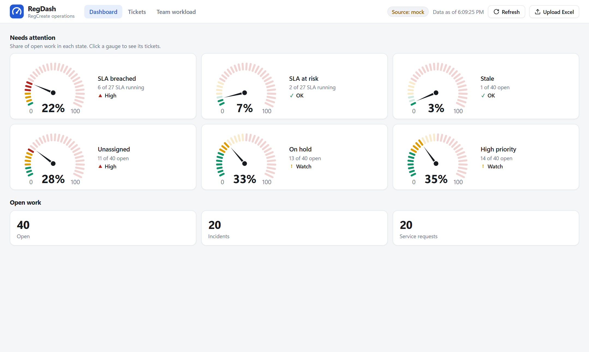
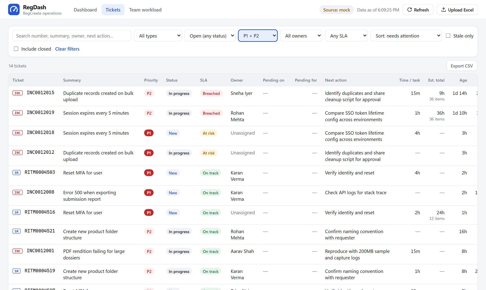
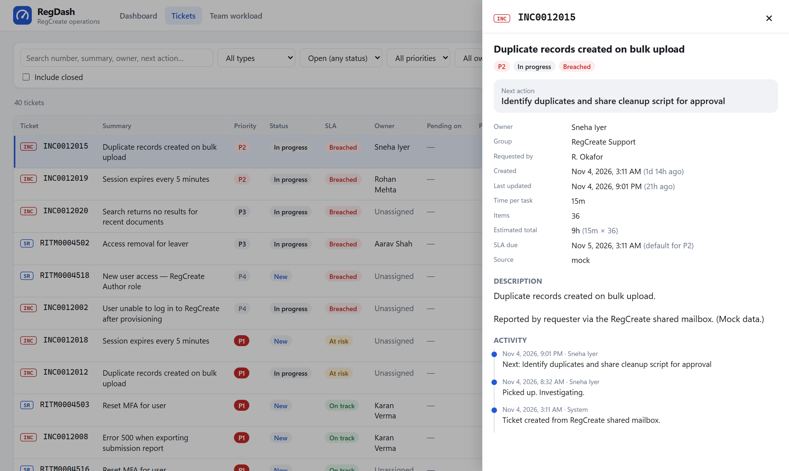
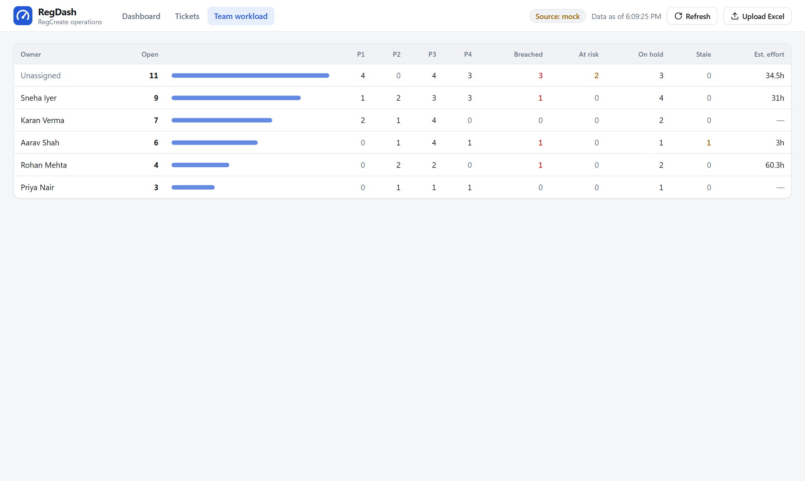
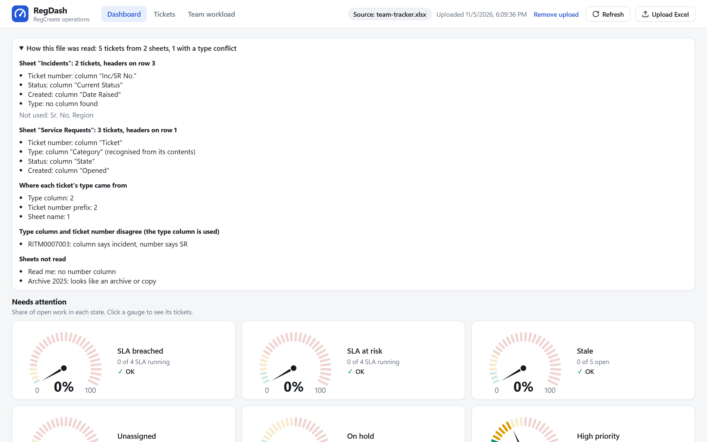
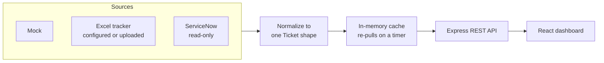

# RegDash

**The RegCreate support team's open work, in one view.** See what's open, what's breaching, who owns it, what it's waiting on and what happens next.


<picture>
  <source media="(prefers-color-scheme: dark)" srcset="docs/screenshots/dashboard-dark.png">
  
</picture>

<sub>All screenshots use generated mock data.</sub>

## Contents

[Features](#features) · [Quick start](#quick-start) · [Pages](#pages) · [Data sources](#data-sources) · [Architecture](#architecture) · [Commands](#commands) · [Before showing it to anyone](#before-showing-it-to-anyone) · [Roadmap](#roadmap)

Phase 1 is read-only visibility. Requirements and design are in **[docs/PHASE-1.md](docs/PHASE-1.md)**.

## Features

| | |
|---|---|
| **Attention gauges** | Breached, at risk, stale, unassigned, on hold and high priority. Needles sweep when new data arrives, and clicking one opens its tickets. |
| **Ticket table** | Filter, search and sort, with filters kept in the URL so a view can be shared. Export the current view as CSV. |
| **Ticket detail** | Next action, blocker, timeline and an Open in ServiceNow link, in a panel beside the list. |
| **Team workload** | Open tickets per engineer, by priority and SLA state, with estimated effort. |
| **Excel upload** | Upload a tracker from the dashboard, with no config change or restart. |
| **Incident and SR detection** | Rules find the right sheet, columns and ticket type in a messy tracker, and show how the file was read. |
| **SLA that pauses** | Tickets waiting on someone outside the team show as Paused, not breached. |
| **Keeps working in an outage** | If a refresh fails, the last good data stays on screen with a clear error. |

<table>
  <tr>
    <td width="50%"><br><sub><b>Tickets:</b> a gauge opens this list already filtered</sub></td>
    <td width="50%"><br><sub><b>Ticket detail:</b> the next action comes first</sub></td>
  </tr>
  <tr>
    <td width="50%"><br><sub><b>Team workload:</b> see who's overloaded</sub></td>
    <td width="50%"><br><sub><b>How this file was read:</b> check the rules' assumptions</sub></td>
  </tr>
</table>

## Quick start

Needs **Node 22.9+** and **pnpm** (`npm i -g pnpm` or `corepack enable`).

```bash
pnpm install
pnpm dev          # API on :4000, dashboard on http://localhost:5173
```

That runs on **mock data** with no setup, and no real company data is involved.

## Pages

| URL | Shows |
|---|---|
| `/` | Dashboard: totals and gauges. Click one to see its tickets |
| `/tickets` | Ticket table with filters |
| `/tickets/INC0012345` | The same table with that ticket's detail panel open |
| `/workload` | Open tickets per engineer |

## Data sources

> [!WARNING]
> Only upload real data, or point `excel` or `servicenow` at it, on your work machine, inside the company network. Never copy real ticket data to a personal device.

### Upload a tracker

Click **Upload Excel** and pick an `.xlsx` file (25 MB max). It becomes the live source, replacing whichever one is configured, until you click **Remove upload**.

- A copy is kept at `EXCEL_UPLOAD_PATH` (default `data/uploaded-tracker.xlsx`, git-ignored) so it survives an API restart. The file at `EXCEL_PATH` is never changed.
- A file that can't be read, or has no usable tickets, is refused with the reason, and the current data stays.
- The dashboard shows what was uploaded and when. It doesn't update until someone uploads a newer file.
- The upload applies to everyone viewing this API, and the API has no login, so keep it on the work machine or internal network.

### Configure a source

```bash
cp .env.example apps/api/.env
```

Then set `DATA_SOURCE` in `apps/api/.env`:

| Value | Reads from | Use for |
|---|---|---|
| `mock` (default) | generated fake tickets | development on any machine |
| `excel` | `EXCEL_PATH` (.xlsx) | a local or OneDrive-synced copy of the SharePoint tracker |
| `servicenow` | ServiceNow Table API | live data (needs a read-only service account) |

To try the Excel source with fake data, run `pnpm sample:excel`, which regenerates `data/sample-tickets.xlsx`, then set `DATA_SOURCE=excel`.

### How Excel files are understood

The tracker doesn't need restructuring. Rules work out:

- **Which sheets to read:** the `EXCEL_SHEET` sheet if there is one, otherwise every visible sheet with tickets, skipping archives and copies.
- **Which columns matter:** by name first, then by contents. A `Sr No` column counting 1, 2, 3 is not mistaken for service requests.
- **Incident or SR:** the type column, then the number prefix (`INC`, `RITM`, `REQ`, `SCTASK`, `SR`), then the sheet name. Rows that none of these can classify are rejected with a reason, not guessed.

These rules haven't yet been checked against the real tracker. After an upload, open **How this file was read** to see each decision. The full rules and column names are in [docs/PHASE-1.md §7](docs/PHASE-1.md).

## Architecture



```text
regdash/
├── apps/
│   ├── api/          Node + Express + TypeScript: sources, cache, REST API
│   └── web/          React + Vite + TypeScript: the dashboard
├── packages/
│   └── shared/       Ticket types, SLA and gauge logic shared by both apps
├── data/             Git-ignored, except the fake sample-tickets.xlsx
└── docs/             Requirements, design and screenshots
```

<details>
<summary><b>REST API</b></summary>

| Endpoint | Purpose |
|---|---|
| `GET /api/health` | Source, last refresh, errors, rejected rows, how a file was read |
| `POST /api/refresh` | Re-pull from the source now |
| `GET /api/summary` | Counts for the dashboard and workload |
| `GET /api/tickets` | List. Filters: `type`, `status`, `priority`, `sla`, `stale`, `assignedTo`, `q`, `includeClosed`, `sort`, `dir` |
| `GET /api/tickets.csv` | The same list and filters, as a CSV download |
| `GET /api/tickets/:number` | One ticket |
| `POST /api/upload?fileName=` | Upload a tracker (raw `.xlsx` body) |
| `DELETE /api/upload` | Remove the upload and return to the configured source |

</details>

## Commands

| Command | What it does |
|---|---|
| `pnpm dev` | API + web with hot reload |
| `pnpm dev:api` / `pnpm dev:web` | one side only |
| `pnpm test` | unit tests (normalization, sources, API, SLA, gauges) |
| `pnpm typecheck` | strict TypeScript across all packages |
| `pnpm build` | typecheck + production build of the web app |
| `pnpm sample:excel` | regenerate the sample tracker workbook |
| `pnpm sn:check` | read-only ServiceNow connection check (work machine, needs `SERVICENOW_*` in `.env`) |

## Before showing it to anyone

- [ ] Replace the placeholder SLA hours in `packages/shared/src/sla.ts` with the team's real SLA matrix.
- [ ] Replace the placeholder gauge limits (`GAUGE_LIMITS` in `packages/shared/src/gauges.ts`) with the limits the team agrees on.
- [ ] Check how the real tracker is read, using **How this file was read**.
- [ ] Agree the `Next:` / `Blocker:` / `Pending:` work-note convention if you're using the ServiceNow source.

## Roadmap

1. **Visibility.** This dashboard ✅
2. **Access automation.** Templated welcome and access emails when a user is provisioned
3. **Mailbox → ServiceNow.** Classify shared-mailbox emails, draft INC/SR, human approves, send acknowledgment
4. **Support copilot.** RAG over SOPs and past tickets to suggest resolutions, with sources
