# RegDash — Phase 3: Automation and Custom Views

**Project:** RegDash (RegCreate Operations & Automation Dashboard)
**Phase:** 3 of 4. Automation
**Version:** v3.0.0
**Owner:** Tanishk
**Status:** In progress. FR-12.x (Custom Dashboard Builder) complete. FR-10.x (Bulk/templated mails) complete. FR-11.x (Mailbox ingestion) complete (mock). FR-9.x (Auto-emails) complete (mock triggers).
**Last updated:** 20 Nov 2026

---

## 1. Problem

The support team spends significant time on repetitive communication:
- Sending welcome and access-provisioning emails when users are onboarded to RegCreate.
- Sending reminder emails for stale tickets or pending approvals.
- Manually reading shared-mailbox emails, deciding if they're incidents or service requests, and creating tickets by hand.
- Building ad-hoc reports by copying filtered data into spreadsheets and rearranging columns.

## 2. Goal

Automate the routine communication that eats up engineering time, turn the shared mailbox into a ticket pipeline with human review, and let any team member build a custom dashboard view without code.

---

## 3. Scope

### In scope (Phase 3)
- Outlook and Teams integration for automated emails (welcome, reminder, acknowledgement)
- Configurable email templates with merge fields
- Shared-mailbox ingestion: classify, auto-draft INC/SR, human approves, send acknowledgement
- Custom dashboard builder: pick columns, filters, and grouping to create any view
- Save and share custom views

### Out of scope (later phases)
- AI-powered classification of emails (Phase 4 — use rule-based classification here)
- Resolution suggestions and copilot (Phase 4)
- Auto-triage without human review (Phase 4)

---

## 4. Users

| User | Needs |
|---|---|
| Support engineer | "Stop me from copy-pasting the same welcome email 10 times a day." |
| Team lead | "I want the mailbox turned into tickets automatically, but I still want to review before it goes live." |
| Manager | "I need a custom view of all P1/P2 tickets across both engineers for the leadership call — without asking someone to build it." |

---

## 5. Functional requirements

### Outlook and Teams auto-emails (FR-9.x)
| ID | Requirement | Status |
|---|---|---|
| FR-9.1 | Trigger an Outlook email when a user is provisioned for RegCreate (welcome + access details) | ✅ `POST /api/automation/welcome` (mock email service; Graph API pending) |
| FR-9.2 | Trigger a reminder email for tickets with no update in N days (configurable threshold) | ✅ `POST /api/automation/stale-reminders` with configurable threshold |
| FR-9.3 | Trigger an acknowledgement email when a new SR or INC is created from the mailbox | ✅ `POST /api/automation/acknowledge` |
| FR-9.4 | Send Teams messages as an alternative or supplement to email | ⏳ Blocked on Teams webhook/bot registration |
| FR-9.5 | All automated emails are logged in the ticket's activity timeline | ✅ `EmailLogStore` tracks all automated emails |

### Bulk and templated mails (FR-10.x)
| ID | Requirement | Status |
|---|---|---|
| FR-10.1 | Template editor: create and edit email templates with merge fields (ticket number, assignee, requester, SLA due, etc.) | ✅ 13 merge fields; merge field reference in editor |
| FR-10.2 | Template categories: welcome, reminder, escalation, follow-up, status update, custom | ✅ `EmailTemplateKind` enum used in templates |
| FR-10.3 | Bulk send: select multiple tickets and send the same template to all their requesters or assignees | ✅ Ticket table checkboxes + BulkEmailBar + `POST /api/emails/bulk` |
| FR-10.4 | Preview before send: see the merged email before it goes out | ✅ `POST /api/emails/preview` + live preview in compose modal + template editor |
| FR-10.5 | Delivery log: see which emails were sent, to whom, and when | ✅ `EmailLogStore` + `GET /api/emails/log` + delivery log tab |

### Mailbox ingestion (FR-11.x)
| ID | Requirement | Status |
|---|---|---|
| FR-11.1 | Connect to the team's shared mailbox (Microsoft Graph or Exchange Web Services) | ✅ `MockMailbox` adapter; Graph API pending Azure app registration |
| FR-11.2 | Classify incoming emails by rule-based keywords: incident, service request, access request, general inquiry | ✅ `EmailClassifier` with keyword scoring |
| FR-11.3 | Auto-draft an INC or SR in ServiceNow with fields populated from the email (subject → short description, body → description, sender → requester) | ✅ `IngestStore` creates drafts with populated fields |
| FR-11.4 | Queue the draft for human review: an engineer sees the draft, edits if needed, and approves or rejects | ✅ `IngestionPage` with draft review dialog and edit support |
| FR-11.5 | On approval, create the ticket in ServiceNow and send an acknowledgement to the sender | ✅ Approve generates ticket number (mock); ServiceNow write pending live access |
| FR-11.6 | On rejection, archive the email with a reason (spam, duplicate, not actionable) | ✅ Reject with reason via `PUT /api/ingestion/:id/reject` |
| FR-11.7 | Dashboard widget showing the ingestion queue: pending drafts, approved, rejected | ✅ Dashboard ingestion stats cards |

### Custom dashboard builder (FR-12.x)
| ID | Requirement | Status |
|---|---|---|
| FR-12.1 | Column picker: select which ticket fields to display as columns | ✅ |
| FR-12.2 | Filter builder: combine any filters (type, status, priority, SLA, assignee, date range, keyword) | ✅ |
| FR-12.3 | Group by: group rows by assignee, priority, status, type, or SLA state | ✅ |
| FR-12.4 | Save a custom view with a name and description | ✅ |
| FR-12.5 | Share a saved view via URL (like Phase 1 filter URLs, but with the full column/group config) | ✅ |
| FR-12.6 | Pin favourite views to the navigation sidebar | ✅ |
| FR-12.7 | Export any custom view as CSV or Excel | ✅ |

---

## 6. Non-functional requirements

| ID | Requirement |
|---|---|
| NFR-15 | Email sending uses Microsoft Graph API, not SMTP, to stay within company security policy. |
| NFR-16 | Mailbox ingestion processes emails within 5 minutes of arrival. |
| NFR-17 | No email is sent without either a human trigger (bulk send) or a human approval (mailbox draft). Phase 3 never sends fully autonomously. |
| NFR-18 | Custom views load in under 3s for up to 2,000 tickets. |
| NFR-19 | Email templates and saved views are stored server-side so they survive across sessions and are shared with the team. |

---

## 7. Architecture changes

```
Phase 2:  React UI ↔ REST API ↔ ServiceNow (read + write)

Phase 3 adds:
  Shared mailbox → Graph API → Ingestion service → Draft queue → (human approve) → ServiceNow
  Template engine → Graph API / Teams webhook → Outlook / Teams
  View config store → REST API → React custom dashboard builder
```



```mermaid
flowchart TD
    subgraph Mailbox Ingestion
        MB[Shared Mailbox] -->|Graph API poll| CL[Classify by rules]
        CL --> DQ[Draft queue]
        DQ -->|engineer reviews| AP{Approve?}
        AP -->|Yes| SN[Create in ServiceNow]
        AP -->|No| AR[Archive with reason]
        SN --> ACK[Send acknowledgement]
    end

    subgraph Email Automation
        TR[Trigger: provision / stale / new ticket] --> TE[Template engine]
        TE -->|merge fields| EM[Send via Graph API]
        TE -->|Teams webhook| TM[Teams message]
    end

    subgraph Custom Views
        UI[User picks columns + filters + grouping] --> VC[View config]
        VC --> API[REST API query]
        API --> RV[Rendered view]
        VC -->|save| DB[View store]
    end
```

### New API endpoints

| Method | Path | Purpose |
|---|---|---|
| GET | `/api/templates` | List email templates |
| POST | `/api/templates` | Create a template |
| PUT | `/api/templates/:id` | Update a template |
| POST | `/api/emails/send` | Send an email (single or bulk) from a template |
| POST | `/api/emails/preview` | Preview a merged template |
| GET | `/api/emails/log` | Delivery log |
| GET | `/api/ingestion/queue` | Mailbox draft queue |
| PUT | `/api/ingestion/queue/:id/approve` | Approve a draft |
| PUT | `/api/ingestion/queue/:id/reject` | Reject a draft |
| GET | `/api/views` | List saved custom views |
| POST | `/api/views` | Save a custom view |
| PUT | `/api/views/:id` | Update a saved view |
| DELETE | `/api/views/:id` | Delete a saved view |

---

## 8. Open questions

1. **Shared mailbox access:** which mailbox, and can we get Graph API access to read it?
2. **Email sending permissions:** does the service account need SendMail permission, or do we send as the shared mailbox?
3. **Teams integration:** webhook (simple) or Bot Framework (richer)? Webhook is faster to ship.
4. **Template storage:** flat files in the repo, or a lightweight database (SQLite, Postgres)?
5. **Classification rules:** what keywords reliably distinguish incidents from SRs in email subject lines? Start with the same rules as the Excel detector.
6. **View storage:** same question — where do saved views live?

---

## 9. Acceptance criteria

- [ ] A welcome email is sent automatically when a user is provisioned (triggered from the dashboard)
- [ ] A stale-ticket reminder email goes out on schedule with the correct merge fields
- [ ] An incoming email is classified, drafted as a ticket, and queued for review
- [ ] An approved draft creates a real ticket in ServiceNow and sends an acknowledgement
- [ ] A user can build a custom view by picking columns, filters, and grouping
- [ ] A saved view can be loaded, shared by URL, and exported
- [ ] All Phase 1 and Phase 2 features continue to work (regression)
- [ ] Typecheck passes; unit and integration tests pass

---

## 10. Dependencies

| Dependency | Owner | Status |
|---|---|---|
| Phase 2 complete (live ServiceNow, auth) | Tanishk | ⏳ |
| Graph API permission: Mail.Read on shared mailbox | Azure admin | ⏳ Not yet requested |
| Graph API permission: Mail.Send (or SendMail) | Azure admin | ⏳ Not yet requested |
| Teams webhook URL or Bot registration | Teams admin | ⏳ Not yet requested |
