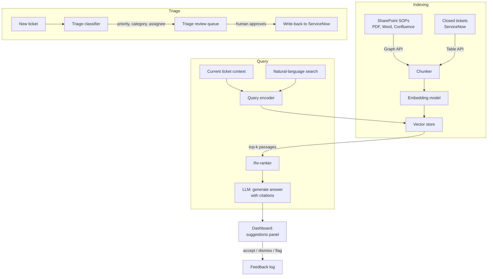

# RegDash — Phase 4: Support Copilot

**Project:** RegDash (RegCreate Operations & Automation Dashboard)
**Phase:** 4 of 4. AI Copilot
**Owner:** Tanishk
**Status:** Not started. Depends on Phase 2 (live ServiceNow) and Phase 3 (mailbox ingestion, templates).
**Last updated:** 18 Nov 2026

---

## 1. Problem

Support engineers spend time re-discovering solutions that the team has already found before. Resolution steps are buried in past ticket notes, SOPs stored in SharePoint, and team chat history. When a new or similar ticket comes in, the engineer starts from scratch or asks around — both slow and error-prone. Ticket triage (priority, category, assignment) is also manual and inconsistent.

## 2. Goal

An AI assistant embedded in the dashboard that surfaces relevant past resolutions and SOP steps when an engineer is working a ticket, and suggests triage decisions for incoming tickets — always with sources, always with human review.

---

## 3. Scope

### In scope (Phase 4)
- RAG (Retrieval-Augmented Generation) pipeline over SOPs, past ticket notes and resolution summaries
- Resolution suggestions shown in the ticket detail panel, with cited sources
- Auto-triage: priority, category and assignment suggestions for new tickets, queued for human review
- Natural-language search across all indexed knowledge from the dashboard

### Out of scope
- Fully autonomous ticket resolution (always human-in-the-loop)
- Customer-facing chatbot or self-service portal
- Training or fine-tuning a custom model (use off-the-shelf LLM with RAG)

---

## 4. Users

| User | Needs |
|---|---|
| Support engineer | "When I open a ticket, show me how similar ones were resolved — don't make me search SharePoint." |
| New team member | "I don't know the SOPs yet. The copilot helps me learn by showing me what the team has done before." |
| Team lead | "I want new tickets triaged consistently, not just by whoever happens to pick them up." |

---

## 5. Functional requirements

### RAG over SOPs and past tickets (FR-13.x)
| ID | Requirement | Status |
|---|---|---|
| FR-13.1 | Index SOP documents from SharePoint (PDF, Word, Confluence pages) into a vector store | ⏳ |
| FR-13.2 | Index resolution notes and work notes from closed tickets (ServiceNow) | ⏳ |
| FR-13.3 | Incremental re-indexing: new documents and newly closed tickets are indexed automatically | ⏳ |
| FR-13.4 | Natural-language search bar in the dashboard: "How do we handle a password reset for RegCreate?" | ⏳ |
| FR-13.5 | Search results show ranked passages with source document, ticket number, and a link to the original | ⏳ |

### Resolution suggestions (FR-14.x)
| ID | Requirement | Status |
|---|---|---|
| FR-14.1 | When viewing a ticket, show a "Suggested resolution" panel with 1-3 suggestions ranked by relevance | ⏳ |
| FR-14.2 | Each suggestion cites its sources: SOP section, past ticket number, or document title | ⏳ |
| FR-14.3 | An engineer can accept a suggestion (copies it into the work note draft), dismiss it, or flag it as unhelpful | ⏳ |
| FR-14.4 | Feedback (accept/dismiss/flag) is logged to improve retrieval quality over time | ⏳ |
| FR-14.5 | Suggestions are generated on-demand (when the panel is opened), not pre-computed | ⏳ |

### Auto-triage (FR-15.x)
| ID | Requirement | Status |
|---|---|---|
| FR-15.1 | New tickets (from ServiceNow or mailbox ingestion) are scored for priority (P1-P4) and category | ⏳ |
| FR-15.2 | A suggested assignee is picked based on current workload and past ticket similarity | ⏳ |
| FR-15.3 | Triage suggestions are shown in a review queue — never applied without a human approving | ⏳ |
| FR-15.4 | On approval, the priority, category and assignment are written back to ServiceNow | ⏳ |
| FR-15.5 | Triage accuracy is tracked: how often does the human change the suggestion? | ⏳ |

---

## 6. Non-functional requirements

| ID | Requirement |
|---|---|
| NFR-20 | **Human-in-the-loop always.** No resolution is applied and no triage decision is committed without an engineer's approval. |
| NFR-21 | **Sources are shown.** Every suggestion must cite at least one source. If the model cannot cite a source, it must say so rather than hallucinate. |
| NFR-22 | Suggestion latency under 5s for a single ticket (acceptable for on-demand generation). |
| NFR-23 | The vector store handles up to 50,000 document chunks without degradation. |
| NFR-24 | Indexed content stays within company-approved systems. If using an external LLM API, ticket content is anonymized or the API is company-approved. |
| NFR-25 | The RAG pipeline and LLM provider are swappable (adapter pattern, like data sources in Phase 1). |

---

## 7. Architecture

### Key design decisions
- **RAG, not fine-tuning.** The knowledge base changes frequently (new SOPs, new tickets). RAG keeps the model current without retraining.
- **Adapter pattern for LLM.** The same interface can use an internal model, Azure OpenAI, or any other provider the company approves. No vendor lock-in.
- **On-demand, not pre-computed.** Suggestions are generated when the engineer asks, so they always reflect the latest index.
- **Feedback loop.** Accept/dismiss/flag signals are stored to measure and improve retrieval quality.

### New API endpoints

| Method | Path | Purpose |
|---|---|---|
| GET | `/api/knowledge/search?q=` | Natural-language search over indexed knowledge |
| GET | `/api/tickets/:number/suggestions` | Resolution suggestions for a ticket |
| POST | `/api/tickets/:number/suggestions/:id/feedback` | Log accept, dismiss, or flag |
| GET | `/api/triage/queue` | Pending triage suggestions |
| PUT | `/api/triage/queue/:id/approve` | Approve triage (write to ServiceNow) |
| PUT | `/api/triage/queue/:id/reject` | Reject and re-triage manually |
| POST | `/api/knowledge/reindex` | Trigger a manual re-index |
| GET | `/api/knowledge/status` | Indexing stats: document count, last indexed, errors |

---

## 8. Open questions

1. **LLM provider:** Azure OpenAI (company-managed), an internal model, or another approved provider?
2. **Vector store:** hosted (Azure AI Search, Pinecone) or self-hosted (ChromaDB, Qdrant)?
3. **SOP access:** can we get Graph API read access to the SharePoint library where SOPs are stored?
4. **Data residency:** are there restrictions on sending ticket content to an external LLM API? If so, anonymization pipeline or on-prem model.
5. **Embedding model:** same provider as the LLM, or a separate lightweight model (e.g. `text-embedding-3-small`)?
6. **Triage rules vs. ML:** start with rule-based triage (like Phase 1 keyword detection) and graduate to ML, or go straight to ML?

---

## 9. Acceptance criteria

- [ ] SOPs and past tickets are indexed and searchable from the dashboard
- [ ] Natural-language search returns relevant passages with source citations
- [ ] Viewing a ticket shows resolution suggestions with cited sources
- [ ] An engineer can accept, dismiss, or flag a suggestion
- [ ] New tickets show triage suggestions (priority, category, assignee) in a review queue
- [ ] An approved triage decision is written back to ServiceNow
- [ ] Triage accuracy metrics are visible to the team lead
- [ ] All Phase 1, 2, and 3 features continue to work (regression)
- [ ] Typecheck passes; unit and integration tests pass
- [ ] No ticket content is sent to an unapproved external service

---

## 10. Dependencies

| Dependency | Owner | Status |
|---|---|---|
| Phase 2 and Phase 3 complete | Tanishk | ⏳ |
| LLM provider approval | Security / Architecture team | ⏳ Not yet requested |
| Vector store infrastructure | Infrastructure team | ⏳ Not yet requested |
| Graph API permission: Sites.Read.All (SharePoint SOPs) | Azure admin | ⏳ Not yet requested |
| Data residency and privacy review | Legal / Compliance | ⏳ Not yet requested |
